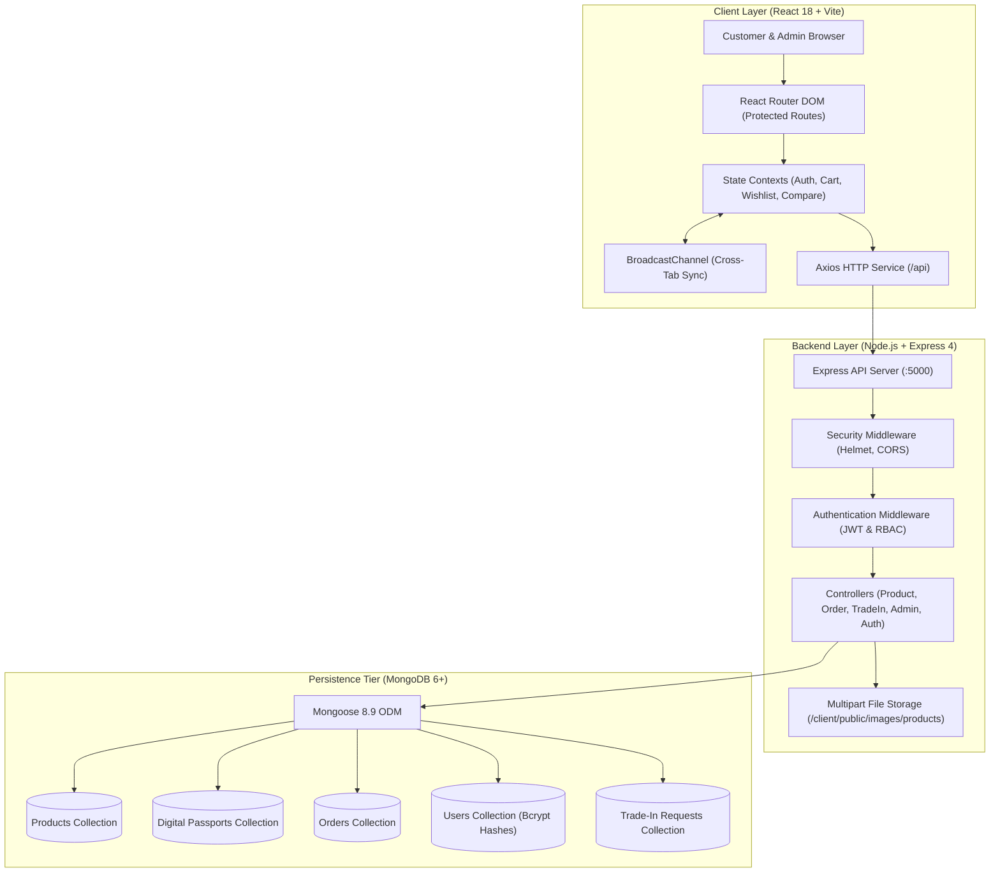

<div align="center">

# RELOOP — Refurbished Electronics Marketplace

<p>
  <strong>Quality Renewed. Value Restored.</strong>
</p>

<p>
  A production-grade, full-stack circular commerce platform built with the MERN stack. Engineered to eliminate the refurbished electronics trust deficit through verified condition grading, device-specific Digital Product Passports (DPP), explainable trade-in valuations, and automated order fulfillment pipelines.
</p>

<p>
  <a href="https://react.dev/"></a>
  <a href="https://vitejs.dev/"></a>
  <a href="https://nodejs.org/"></a>
  <a href="https://expressjs.com/"></a>
  <a href="https://www.mongodb.com/"></a>
  <a href="https://mongoosejs.com/"></a>
  <a href="https://getbootstrap.com/"></a>
  <a href="LICENSE"></a>
</p>

---

[Overview](#overview) •
[Visual Showcase](#visual-showcase) •
[Core Features](#core-features) •
[Architecture](#architecture) •
[Technology Stack](#technology-stack) •
[Project Structure](#project-structure) •
[Getting Started](#getting-started) •
[Configuration](#configuration) •
[Testing & Quality](#testing--quality) •
[Security & Isolation](#security--isolation) •
[Project Scope](#project-scope) •
[Credits & Licensing](#credits--licensing)

---

<p align="center">
  
</p>

</div>

---

## Overview

The refurbished electronics industry struggles with severe information asymmetry: consumers cannot independently verify internal component degradation, battery health, or cosmetic wear, while honest sellers lack standardized tools to certify authentic refurbishment.

**RELOOP** bridges this trust deficit through a cohesive circular commerce architecture:

* **Cryptographic Digital Product Passports (DPP)**: Every certified device is assigned a unique, immutable serial ID detailing a 100-point diagnostic inspection score, verified battery health percentage, cycle counts, component provenance, and ecological impact metrics.
* **Explainable Condition Grading**: Standardized grading tiers (*Pristine*, *Excellent*, *Good*, *Fair*) paired with explicit hardware disclosures, benchmarked against original retail prices.
* **Explainable Trade-In Valuation**: An algorithmic valuation engine that computes instant, transparent buyback quotes with an itemized deduction ledger based on device age, cosmetic wear, and component defects.
* **Dual-Portal Role-Based Access Control (RBAC)**: Strict segregation between consumer storefront workflows and an enterprise administrative portal managing catalog inventory, orders, fulfillment state machines, and trade-in inspection approvals.

---

## Visual Showcase

The platform features high-definition brand campaigns and authentic photographic assets across the circular commerce lifecycle:

| Certified Hardware & Laptops | Flagship Smartphones & Genuine Parts |
| :---: | :---: |
|  |  |
| **Rigorous 100-Point Inspection**<br>Premium ultrabooks and mobile workstations with factory diagnostic verification and up to 40% savings. | **Genuine OEM Components**<br>Flagship smartphones certified with 85%+ battery health and pristine display integrity. |

| Transparent Trade-In Engine | High-Performance Gaming Gear |
| :---: | :---: |
|  |  |
| **Instant Algorithmic Valuation**<br>Itemized deduction models for fair trade-in credit, incentivizing circular electronics lifecycle and e-waste diversion. | **Stress-Tested Gaming Systems**<br>Benchmarked desktop GPUs, CPUs, and consoles validated under thermal load for sustained gaming performance. |

---

## Core Features

### 🛒 Consumer Storefront & Catalog
* **Multi-Category Discovery**: Filter across 8 dedicated categories (*Laptops*, *Smartphones*, *Audio*, *Tablets*, *PC Components*, *Wearables*, *Gaming*, *Cameras*) with dynamic badge counters and condition tags.
* **MongoDB Full-Text Search**: Indexed search queries across device titles, brands, specifications, and condition summaries.
* **Live Side-by-Side Comparison**: Floating comparison tray supporting up to 4 concurrent devices with side-by-side technical specs, diagnostic scores, battery health, and warranty coverage.
* **Authentic Device Assets**: Curated photographic assets with automatic SVG fallbacks when custom photography is unassigned.

### 🛡️ Digital Product Passports (DPP)
* **Cryptographic Serial Identification**: Device-specific identifier (e.g., `RLP-2026-APPLE-4912`) providing complete hardware traceability.
* **100-Point Diagnostic Reports**: Granular scoring of logic board stability, display authenticity, camera modules, sensors, and wireless connectivity.
* **Battery Health Transparency**: Exact battery cycle count, peak capacity percentage, and degradation status.
* **Refurbishment Audit Log**: Timestamped record of sanitized components, replaced batteries/screens, and authorized technician sign-offs.
* **Ecological Impact Tracking**: Real-time calculation of diverted e-waste (kg) and avoided carbon footprint ($\text{CO}_2\text{e}$) per device.

### 💳 Cart, Checkout & Simulated Commerce
* **Anti-Tampering Price Integrity**: Checkout calculations strictly enforce database catalog pricing; client-supplied price modifications are discarded.
* **Atomic Inventory Decrements**: MongoDB transactional decrement queries (`$inc: { stockCount: -quantity }`) guarded by stock checks prevent overselling during checkout.
* **Multi-Channel Sandbox Payments**: Cash on Delivery (COD) with deferred status, simulated instant UPI payments, and sandbox Credit/Debit Card validation.
* **Order Confirmation Celebration**: Canvas-based confetti animation and celebration modal on order completion with automated redirection to order history tracking.

### ♻️ Trade-In Valuation Workflow
* **Explainable Pricing Algorithm**: Mathematical trade-in model factoring device release year, cosmetic condition grade, display defects, and battery wear.
* **Itemized Deduction Ledger**: Complete breakdown showing base valuation, cosmetic wear penalty, and defect deductions before submission.
* **Customer Dashboard Tracking**: Authenticated customers track trade-in submission progress, valuation reviews, and voucher approvals in real time.

### 📊 Administrator Operations Portal
* **Real-Time Database KPIs**: Live aggregated metrics tracking active catalog volume, order pipeline volume, gross revenue, and pending trade-in inspections.
* **Complete Product Lifecycle Management**: Full CRUD modal for creating and updating devices, uploading authentic product images via multipart storage, and mutating linked Digital Product Passports.
* **Order Fulfillment Stepper**: Multi-stage state machine transitions (*Pending* $\rightarrow$ *Processing* $\rightarrow$ *Dispatched* $\rightarrow$ *Delivered* $\rightarrow$ *Cancelled*) with explicit payment collection triggers for COD orders.
* **Trade-In Voucher Generation**: Admin workflow to review hardware condition, approve or adjust valuations, and issue redemption voucher codes.

### ⚡ Enterprise Frontend Engineering
* **Cross-Tab State Synchronization**: Built with the HTML5 `BroadcastChannel` API, cart updates, wishlist changes, and session terminations instantly synchronize across all active browser tabs without page reloads.
* **Cache-Busting Anti-Stale Headers**: Dynamic API routes emit `Cache-Control: no-store, no-cache, must-revalidate` to prevent stale administrative or customer order records from browser memory.
* **Custom Scoped CSS Design System**: Responsive CSS with deep navy (`#0B132B`), emerald green (`#087F5B`), warm ivory (`#F8F9FA`), and gold accents, with full `prefers-reduced-motion` accessibility support.

---

## Architecture

RELOOP is designed as a decoupled Single-Page Application (SPA) driven by React 18 and Vite, interacting via a RESTful API with Express.js and MongoDB.



---

## Technology Stack

| Domain | Technology | Version | Purpose |
| :--- | :--- | :---: | :--- |
| **Frontend Framework** | [React](https://react.dev/) | `18.3.1` | Component-based Single-Page Application |
| **Build & Dev Tool** | [Vite](https://vitejs.dev/) | `5.4.11` | Optimized ES module bundler and Fast Refresh |
| **Client Routing** | [React Router DOM](https://reactrouter.com/) | `6.28.0` | Client-side routing with role-based route guards |
| **Styling & Layout** | [Bootstrap](https://getbootstrap.com/) | `5.3.3` | Responsive grid, utility classes, and base components |
| **Custom Styling** | Vanilla Scoped CSS | — | Design system tokens, micro-interactions, animations |
| **Iconography** | [Lucide React](https://lucide.dev/) | `0.460.0` | Crisp, accessible iconography |
| **HTTP Client** | [Axios](https://axios-http.com/) | `1.7.9` | Promise-based HTTP client with request interceptors |
| **Backend Runtime** | [Node.js](https://nodejs.org/) | `18+ LTS` | Server-side JavaScript runtime |
| **Web API Framework** | [Express](https://expressjs.com/) | `4.21.2` | RESTful API server routing and middleware pipeline |
| **Database Engine** | [MongoDB](https://www.mongodb.com/) | `6.0+ / 7.0+` | NoSQL document database with full-text indexes |
| **ODM Library** | [Mongoose](https://mongoosejs.com/) | `8.9.5` | Schema validation, compound indexing, query building |
| **Authentication** | [jsonwebtoken](https://github.com/auth0/node-jsonwebtoken) | `9.0.3` | Stateless signed JSON Web Tokens (JWT) |
| **Password Hashing** | [bcryptjs](https://www.npmjs.com/package/bcryptjs) | `3.0.3` | Salted one-way password hashing (10 salt rounds) |
| **API Security** | [Helmet](https://helmetjs.github.io/) | `8.0.0` | HTTP security response header hardening |
| **CORS Management** | [CORS](https://www.npmjs.com/package/cors) | `2.8.5` | Cross-Origin Resource Sharing control |
| **Environment Mgmt** | [dotenv](https://www.npmjs.com/package/dotenv) | `16.4.7` | Environment variable isolation |

---

## Project Structure

```
RELOOP/
├── client/                               # Frontend Single-Page Application (React 18 + Vite)
│   ├── public/
│   │   └── images/
│   │       ├── campaigns/                # Promotional campaign banners (4 assets)
│   │       └── products/                 # Authentic device photos & SVG fallback icons
│   ├── src/
│   │   ├── components/
│   │   │   ├── admin/                    # AdminLayout, AdminSidebar, AdminProductModal
│   │   │   ├── common/                   # Navbar, Footer, CategoryBar, OrderCelebration
│   │   │   ├── compare/                  # Floating device spec comparison tray
│   │   │   ├── home/                     # Hero carousel, featured categories, trust grid
│   │   │   ├── passport/                 # Digital Product Passport modal & diagnostics
│   │   │   └── product/                  # Product cards, badges, filter controls
│   │   ├── context/                      # React Context providers (Auth, Cart, Wishlist, Compare)
│   │   ├── pages/                        # Storefront, PDP, Cart, Checkout, Profile, Admin views
│   │   ├── services/                     # Axios API instance and BroadcastChannel sync bridge
│   │   └── styles/                       # Global CSS tokens, animations, and micro-interactions
│   ├── index.html                        # SPA HTML entry point
│   ├── package-lock.json                 # Client dependency lockfile
│   ├── package.json                      # Client package manifest
│   └── vite.config.js                    # Vite bundler configuration
│
├── server/                               # Backend REST API (Node.js + Express 4)
│   ├── config/                           # MongoDB connection & schema index initialization
│   ├── controllers/                      # Business logic handlers (admin, auth, order, product, tradeIn)
│   ├── middleware/                       # JWT auth, RBAC guards, error handler, cache-control
│   ├── models/                           # Mongoose schemas (Product, DigitalPassport, Order, User, etc.)
│   ├── routes/                           # Modular Express route definitions
│   ├── test/                             # Automated test suites
│   ├── utils/                            # Token generator & helper utilities
│   ├── .env.example                      # Sanitized environment blueprint (no secrets)
│   ├── package-lock.json                 # Server dependency lockfile
│   ├── package.json                      # Server package manifest & test scripts
│   └── server.js                         # Application entry point
│
├── docs/                                 # Architectural specifications & licensing logs
│   ├── ARCHITECTURE.md                   # In-depth architectural blueprint
│   ├── PRODUCT_IMAGES_PROVENANCE.md      # Wikimedia Commons attribution & licensing log
│   ├── PROJECT_PLAN.md                   # Delivery roadmap & milestone tracking
│   ├── TEST_CHECKLIST.md                 # Verification test matrices
│   └── UI_REFERENCE_AUDIT.md             # Design system audit & accessibility notes
│
├── scripts/                              # Operational scripts
│   ├── acquire-real-images.js            # Image synchronization utility with Wikimedia Commons
│   ├── backup_db.js                      # MongoDB JSON snapshot tool
│   ├── expand-catalog-31.js              # Catalog fixture expansion tool
│   └── launcher.js                       # Cross-process supervisor with port collision handling
│
├── .gitignore                            # Root ignore rules (excludes .env, data/, node_modules)
├── OPEN_DATABASE_GUI.bat                 # One-click Windows launcher for MongoDB Compass
├── START_RELOOP.bat                      # One-click Windows application launcher
├── STOP_RELOOP.bat                       # One-click Windows clean shutdown utility
├── README.md                             # Repository documentation
└── package.json                          # Monorepo root scripts
```

### Directory Responsibilities

| Path | Primary Responsibility |
| :--- | :--- |
| `client/src/components/` | Modular, domain-driven UI components (admin, common, compare, home, passport, product). |
| `client/src/context/` | Centralized state management for authentication, cart, wishlist, and comparison trays. |
| `client/src/pages/` | Top-level routed views for catalog, product details, checkout, profile, and admin dashboards. |
| `client/src/services/` | Axios HTTP client configured with base URL, timeout, and `BroadcastChannel` cross-tab synchronization. |
| `server/controllers/` | Request processing, input sanitization, database queries, and business logic execution. |
| `server/middleware/` | JWT token validation, admin RBAC guards, error formatting, and cache-control headers. |
| `server/models/` | Strictly typed Mongoose schemas with compound indexes, virtuals, and pre-save hooks. |
| `server/test/` | Automated test suites executing live API verification and regression protection. |
| `docs/` | Technical documentation covering architecture, test checklists, and asset licensing provenance. |
| `scripts/` | Process orchestration, port collision management, and database snapshot utilities. |

---

## Getting Started

### Prerequisites

1. **Node.js**: Version 18.0.0 or higher ([Download Node.js](https://nodejs.org/))
   ```bash
   node --version
   npm --version
   ```
2. **MongoDB Community Server**: Active locally on port `27017` ([Download MongoDB](https://www.mongodb.com/try/download/community))
   ```bash
   # Verify MongoDB is running
   mongosh --eval "db.adminCommand('ping')"
   ```

---

### Installation & Setup

1. **Clone the repository**:
   ```bash
   git clone https://github.com/kingston-shasanth/RELOOP-refurbished-electronics-marketplace.git
   cd RELOOP-refurbished-electronics-marketplace
   ```

2. **Configure Environment Variables**:
   Copy the sanitized blueprint in `server/`:
   ```bash
   # Windows Command Prompt
   copy server\.env.example server\.env

   # PowerShell / Bash
   cp server/.env.example server/.env
   ```

3. **Install Dependencies**:
   ```bash
   # Install server dependencies
   cd server
   npm install

   # Install client dependencies
   cd ../client
   npm install

   # Return to project root
   cd ..
   ```

---

### Starting the Application

#### Option A: One-Click Windows Launchers (Recommended)

| Script | Purpose |
| :--- | :--- |
| [`START_RELOOP.bat`](START_RELOOP.bat) | Pre-flight MongoDB port 27017 check, port collision auto-routing, spawns Express API and Vite client, streams prefixed logs, and opens `http://localhost:5173` in your default browser. |
| [`STOP_RELOOP.bat`](STOP_RELOOP.bat) | Gracefully terminates only recorded RELOOP backend and frontend processes (`.reloop_pids.json`) without killing unrelated Node.js sessions. |
| [`OPEN_DATABASE_GUI.bat`](OPEN_DATABASE_GUI.bat) | Automatically locates MongoDB Compass and launches a direct inspection session into `mongodb://127.0.0.1:27017` / `reloop`. |

```bat
:: Double-click from Windows Explorer or run in terminal:
START_RELOOP.bat
```

#### Option B: Manual Cross-Platform Startup

You can run services from the project root using two terminal windows:

```bash
# Terminal 1 — Backend Express API (Port 5000)
npm run server

# Terminal 2 — Frontend Vite Client (Port 5173)
npm run client
```

#### Application URLs
| Service | Endpoint URL | Purpose |
| :--- | :--- | :--- |
| **Storefront & Admin UI** | `http://localhost:5173` | Customer marketplace, PDP, checkout, and admin dashboard |
| **API Health Probe** | `http://localhost:5000/api/health` | Service uptime, status, and environment metadata |
| **Database Health Probe** | `http://localhost:5000/api/health/db` | MongoDB connection state verification |
| **Base API Route** | `http://localhost:5000/` | Service welcome banner and available endpoints |

---

## Configuration

Server environment configuration is read from `server/.env`. A sanitized blueprint is maintained at [`server/.env.example`](server/.env.example).

### Blueprint (`server/.env.example`)
```ini
# RELOOP Server Environment Configuration Blueprint
# Copy this file to .env and configure for your local environment

NODE_ENV=development
PORT=5000

# Local MongoDB Connection URI
MONGO_URI=mongodb://127.0.0.1:27017/reloop

# Frontend Client Origin for CORS
CLIENT_URL=http://localhost:5173

# JWT Secret for Session Token Signing
JWT_SECRET=reloop_secure_jwt_secret_development_key
```

> [!IMPORTANT]
> The active `server/.env` contains local environment secrets. It is strictly excluded by `.gitignore` and must never be committed to source control.

---

## Testing & Quality

RELOOP includes a comprehensive, multi-tiered verification suite covering server health, API compliance, image upload persistence, defect regressions, and full end-to-end commerce flows.

Every automated test suite executes against the live local database and purges its disposable test records, ensuring **100% zero database pollution**.

### Verified Test Matrix

| Command | Suite | Focus & Verification Scope | Outcome |
| :--- | :--- | :--- | :---: |
| `npm run test:health` | **Health & DB Check** | Validates base welcome route, `/api/health`, `/api/health/db`, CORS headers, 404 handler, and Mongoose schema compilation. | `6 / 6 PASSED` |
| `npm run test:audit` | **Compliance Audit** | Full-stack audit of customer auth, product filtering, text search, DPP retrieval, trade-in calculations, and admin RBAC. | `18 / 18 PASSED` |
| `npm run test:upload` | **Asset Upload & Sync** | Validates multipart product photo upload (`POST /api/upload`), disk persistence, database linking, and storefront retrieval. | `5 / 5 PASSED` |
| `npm run test:defects` | **Defect Resolution** | Targeted verification of session isolation, cache-control headers, DPP mutation persistence, and atomic inventory decrements. | `12 / 12 PASSED` |
| `npm run test:regression` | **15-Point Regression** | Validates pricing calculations, atomic stock decrements, image fallbacks, order state machines, and sticky positioning. | `15 / 15 PASSED` |
| `npm run test:e2e` | **Master E2E Lifecycle** | Complete commerce lifecycle: registration, catalog browsing, cart operations, checkout, order history, and admin fulfillment. | `35 / 35 PASSED` |
| `npm run build` | **Production Bundle** | Vite client production build with gzip size computation and chunk optimization. | `SUCCESS (0 errors)` |

### Executing Tests

Run any test suite directly from the project root:

```bash
# Verify API and Database Connectivity
npm run test:health

# Run the 18-Point Compliance Audit
npm run test:audit

# Run the Multipart Asset Upload Test
npm run test:upload

# Run the Targeted Defect Verification Suite
npm run test:defects

# Run the 15-Point Regression Suite
npm run test:regression

# Run the Master 35-Point End-to-End Suite
npm run test:e2e

# Compile Frontend Production Bundle
npm run build
```

---

## Security & Isolation

### Role-Based Access Control (RBAC)
* **Explicit Token Claims**: JSON Web Tokens carry explicit user identity and role claims (`role: "customer"` or `role: "admin"`).
* **Route Guards**: Administrative endpoints are protected by `authMiddleware` and `adminOnly` guards. Customer tokens attempting to invoke `/api/admin/*` are rejected with `403 Forbidden`.
* **Multi-Tab Session Isolation**: Admin and customer authentication states are isolated. Logging in as an administrator in one tab does not corrupt or compromise active customer sessions in another context.

### Anti-Tamper Commerce Logic
* **Authoritative Server Pricing**: The checkout controller queries the MongoDB catalog directly to compute item pricing, taxes, and order totals. Client-supplied price modifications are completely discarded.
* **Atomic Stock Decrements**: Product stock is decremented atomically during order placement using MongoDB conditional operators, eliminating race conditions and preventing overselling.

### Cache Invalidation
* All dynamic `/api/*` routes send explicit anti-caching headers (`Cache-Control: no-store, no-cache, must-revalidate, proxy-revalidate`) to guarantee that sensitive customer orders and administrative inventory counts are never cached by intermediaries or browser caches.

---

## Project Scope

### Implemented & Verified Capabilities
* Complete customer circular commerce lifecycle: browsing, filtering, search, condition inspection, Digital Product Passport review, cart management, wishlist, and simulated checkout.
* Complete administrative operations portal: real-time KPI metrics, catalog CRUD, image upload, order fulfillment stepper, and trade-in review.
* Simulated payment sandbox: Cash on Delivery (COD), UPI simulation, and Credit/Debit Card validation.
* Responsive design with subtle micro-interactions, page transition animations, and order confirmation celebrations.

### Project Limitations & Future Roadmap
* **Payment Processing**: The current checkout uses a simulated payment sandbox. Production deployment requires integration with a live payment gateway (e.g., Stripe, Razorpay).
* **Logistics Integration**: Delivery tracking stages are managed via the administrative fulfillment stepper rather than live carrier webhooks (e.g., FedEx, Delhivery).
* **Blockchain Storage**: Digital Product Passports use cryptographic SHA-256 ledger references stored within MongoDB; integration with a public or consortium blockchain (e.g., Polygon) represents a future extension.
* **Email/SMS Notifications**: Order confirmation and dispatch notifications are presented in-app rather than transmitted via SMTP or SMS gateway.

---

## Credits & Licensing

* **Asset Provenance**: Product photographic assets and campaign imagery are cataloged with source URLs, licensing notices, and public-domain attributions in [`docs/PRODUCT_IMAGES_PROVENANCE.md`](docs/PRODUCT_IMAGES_PROVENANCE.md). Third-party photographic assets remain subject to their respective Creative Commons or Wikimedia licenses.
* **License**: This project is licensed under the **ISC License**. Developed as an engineering portfolio implementation demonstrating circular commerce, full-stack state synchronization, and digital product passport verification.
