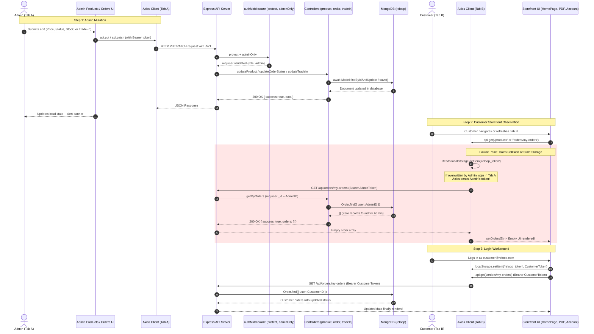
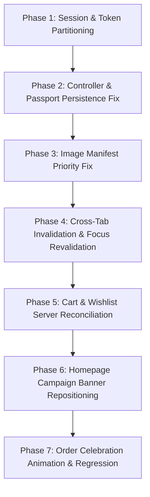

# RELOOP — FORENSIC INVESTIGATION REPORT
## Admin–Customer Data Consistency, Full-Stack Synchronization & UI/UX Audit

**Project:** `D:\RELOOP`  
**Investigation Date:** 2026-10-26  
**Status:** Investigation & Planning Only — No Code or Database Records Modified  
**Report File:** `D:\RELOOP\RELOOP_FORENSIC_INVESTIGATION_REPORT.md`  
**Authors / Roles:** Senior Full-Stack Architect, React State Management Specialist, Node.js/Express Backend Engineer, MongoDB Data Integrity Auditor, and UI/UX Engineer  

---

## TABLE OF CONTENTS
1. [Section A — Executive Summary](#section-a--executive-summary)
2. [Section B — Full-Stack Architecture Map](#section-b--full-stack-architecture-map)
3. [Section C — Entity-by-Entity Synchronization Matrix](#section-c--entity-by-entity-synchronization-matrix)
4. [Section D — Deep Forensic Root-Cause Analysis](#section-d--deep-forensic-root-cause-analysis)
5. [Section E — Recommended Synchronization Design & Architecture](#section-e--recommended-synchronization-design--architecture)
6. [Section F — Database Authority, Security & API Integrity](#section-f--database-authority-security--api-integrity)
7. [Section G — UI/UX Audit: Homepage First-Screen Campaign Banners](#section-g--uiux-audit-homepage-first-screen-campaign-banners)
8. [Section H — UI/UX Audit: Order-Placement Celebration](#section-h--uiux-audit-order-placement-celebration)
9. [Section I — Regression & Existing-Functionality Audit](#section-i--regression--existing-functionality-audit)
10. [Section J — Prioritized Phased Implementation Plan](#section-j--prioritized-phased-implementation-plan)
11. [Section K — Identified Ambiguities, Risks & Blockers](#section-k--identified-ambiguities-risks--blockers)

---

## SECTION A — EXECUTIVE SUMMARY

### The Observed Anomaly
A serious reliability and data consistency bug was observed during platform evaluations:
> *"When an action is performed in the Admin Panel, the corresponding change does not consistently appear in the customer-facing website, even after refreshing the customer tab. Sometimes the change appears only after logging in again."*

### Primary Investigation Findings
A forensic source-code and runtime environment audit of `D:\RELOOP` revealed that this issue does **not** stem from a database write failure, network drop, or server-side caching daemon. MongoDB writes are awaited and persisted properly. Rather, the breakdown occurs due to **five interrelated architectural defects spanning authentication token collisions, client-side caching, missing sub-document mutation logic, and an asset-manifest override**:

1. **Multi-Tab Single-Storage Session Collision (`AuthContext.jsx` & `api.js`) [Primary Smoking Gun for "Appears Only After Logging In Again"]**:
   The admin panel and customer storefront share the same browser origin (`http://localhost:5173`). Both rely on identical localStorage keys (`reloop_token` and `reloop_user`). When an administrator logs into Tab A, Tab A overwrites `reloop_token` in `localStorage` with the administrator's JWT. When Tab B (the customer tab) refreshes or navigates to `/account` (`AccountPage.jsx`), the Axios request interceptor (`api.js:13`) injects the *Admin's* token into requests for `/api/orders/my-orders` and `/api/trade-in/my-requests`. The backend controller filters records by `req.user._id` (the admin user), which owns zero customer orders and zero trade-in requests. Consequently, Tab B renders completely empty lists. When the user logs in again as `customer@reloop.com`, `reloop_token` is restored to the customer's JWT, and the updated order status and approved trade-in vouchers suddenly appear.

2. **Silent Catch Blocks Swallowing Auth Errors (`AccountPage.jsx:54-55`)**:
   `AccountPage.jsx` wraps its data loading in `.catch(() => ({ data: { success: false, orders: [] } }))`. Any 401 or role-mismatch error fails silently without a notification or redirect, leaving the customer with an empty UI and no indication of session desynchronization.

3. **Static Image Manifest Overriding Live Product Image Updates (`ProductImage.jsx:56-59`)**:
   When an administrator edits a product's photograph in `AdminProductModal.jsx` and saves a new image path (e.g. `/images/products/custom-upload.jpg`), `ProductImage.jsx` checks `productImagesManifest.json` *before* checking `src`. If the product's slug matches a manifest entry, `ProductImage` discards the updated database path and forces the hardcoded image. As a result, newly updated product images never appear on the storefront.

4. **Missing Digital Passport Persistence in Product Updates (`productController.js:347`)**:
   In `productController.js`, `updateProduct` calls `Product.findByIdAndUpdate(id, req.body)`. However, diagnostic scores and lab inspection telemetry are stored in the separate `DigitalPassport` collection (`server/models/DigitalPassport.js`). The controller does not forward updates to the linked `DigitalPassport` document. Changes made to diagnostic scores in the admin modal are silently discarded by Mongoose's strict schema filter.

5. **Local Storage Cart & Wishlist Stagnation (`CartContext.jsx` & `WishlistContext.jsx`)**:
   `CartContext` and `WishlistContext` serialize entire product objects into `localStorage` (`reloop_cart`, `reloop_wishlist`). Neither context ever validates or reconciles prices or stock counts against the server on mount or tab refresh. If an administrator alters a product's price or stock, the customer's cart continues to display stale values until checkout submission.

6. **Missing HTTP `Cache-Control` Headers on REST Endpoints (`server.js`)**:
   The Express server does not set `Cache-Control: no-cache, no-store, must-revalidate` on API responses. In certain browsers and client-side navigation paths, GET responses can be served from memory or disk caches rather than hitting the backend.

---

## SECTION B — FULL-STACK ARCHITECTURE MAP

The diagram below traces the end-to-end data lifecycle across administrative mutations, Express middleware, MongoDB persistence, and customer retrieval paths.



### Real Application File & Function Mapping

| Workflow Layer | Concrete File Path | Functions / Components |
|---|---|---|
| **Admin UI** | `client/src/pages/admin/AdminProductsPage.jsx`<br>`client/src/components/admin/AdminProductModal.jsx`<br>`client/src/pages/admin/AdminOrdersPage.jsx`<br>`client/src/pages/admin/AdminTradeInsPage.jsx` | `handleSubmit`, `handleUpdateStatus`, `handleApprove`, `fetchProducts`, `fetchOrders` |
| **API Client** | `client/src/services/api.js` | Axios instance, request interceptor (Bearer token injection), response error interceptor |
| **Global State** | `client/src/context/AuthContext.jsx`<br>`client/src/context/CartContext.jsx`<br>`client/src/context/WishlistContext.jsx` | `AuthProvider` (`user`, `token`), `CartProvider` (`cartItems`), `WishlistProvider` (`wishlistItems`) |
| **Server Entry & Middlewares** | `server/server.js`<br>`server/middleware/authMiddleware.js`<br>`server/middleware/errorMiddleware.js` | `app.use('/api/*')`, `protect`, `adminOnly`, `notFound`, `errorHandler` |
| **Controllers** | `server/controllers/productController.js`<br>`server/controllers/orderController.js`<br>`server/controllers/tradeInController.js`<br>`server/controllers/adminController.js` | `createProduct`, `updateProduct`, `getProducts`, `updateOrderStatus`, `getMyOrders`, `updateTradeInStatus`, `getMyTradeIns` |
| **MongoDB Models** | `server/models/Product.js`<br>`server/models/DigitalPassport.js`<br>`server/models/Order.js`<br>`server/models/TradeInRequest.js`<br>`server/models/User.js` | Mongoose schemas, text indexes, pre/post hooks, validation rules |
| **Customer UI** | `client/src/pages/HomePage.jsx`<br>`client/src/pages/ProductsPage.jsx`<br>`client/src/pages/ProductDetailPage.jsx`<br>`client/src/pages/AccountPage.jsx`<br>`client/src/pages/CartPage.jsx` | `HomePage`, `ProductsPage`, `ProductDetailPage`, `AccountPage`, `CartPage` |

---

## SECTION C — ENTITY-BY-ENTITY SYNCHRONIZATION MATRIX

The table below catalogs every administrative entity, its mutation route, persistence behavior, customer consumption path, and identified defect:

| Entity | Admin Mutation UI & Function | Backend Endpoint & Middleware | Database Write Operation | Customer Read Endpoint & UI | Customer Refresh Behavior | Identified Defect & Root Cause |
|---|---|---|---|---|---|---|
| **1. Product Creation** | `AdminProductModal.jsx`<br>`handleSubmit()` (line 132) | `POST /api/products`<br>`protect`, `adminOnly` | `Product.create(...)`<br>`DigitalPassport.create(...)`<br>Awaited: **Yes** | `GET /api/products`<br>`HomePage.jsx`<br>`ProductsPage.jsx` | Fetches on mount and URL query change. Does not update open tabs without manual reload. | **Minor:** Lack of cross-tab invalidation (`BroadcastChannel`). Also, on `HomePage.jsx`, new items only display if they match category filters and fall in top 4 sliced items (`.slice(0, 4)`). |
| **2. Product Price & Specs Edit** | `AdminProductModal.jsx`<br>`handleSubmit()` (line 172) | `PUT /api/products/:id`<br>`protect`, `adminOnly` | `Product.findByIdAndUpdate(...)`<br>Awaited: **Yes** | `GET /api/products/:identifier`<br>`ProductDetailPage.jsx` | Fetches on mount with `useParams()`. | **Severe:** If slug is changed by admin, customer viewing `/products/:old-slug` gets 404 on refresh. In cart/wishlist, stale price persists because `CartContext` reads from `localStorage`. |
| **3. Product Image Replacement** | `AdminProductModal.jsx`<br>`handleImageFileUpload()` | `POST /api/upload`<br>`PUT /api/products/:id` | Image written to `public/images/products/`<br>Path saved in MongoDB | `ProductImage.jsx`<br>`ProductCard.jsx`<br>`ProductDetailPage.jsx` | Image request sent on refresh. | **Critical:** `ProductImage.jsx:57` checks `productImagesManifest[slug]` *before* `src`. It overrides any updated database image path with the hardcoded manifest file. |
| **4. Inventory & Stock Changes** | `AdminProductModal.jsx`<br>`formData.stockCount` | `PUT /api/products/:id`<br>`protect`, `adminOnly` | `Product.findByIdAndUpdate(...)`<br>Awaited: **Yes** | `GET /api/products/:id`<br>`ProductDetailPage.jsx`<br>`CartPage.jsx` | `ProductDetailPage` updates on refresh. `CartPage` does **not** update. | **Critical:** `CartContext.jsx` initializes from `localStorage.getItem('reloop_cart')` and never refetches product stock from server. Out-of-stock items still appear in cart. |
| **5. Order Fulfillment Status** | `AdminOrdersPage.jsx`<br>`handleUpdateStatus()` (line 54) | `PATCH /api/orders/:id/status`<br>`protect`, `adminOnly` | `order.orderStatus = status`<br>`statusTimeline.push(...)`<br>`await order.save()` | `GET /api/orders/my-orders`<br>`AccountPage.jsx` | `useEffect(..., [])` runs on mount. Silent catch on failure. | **Catastrophic (Session Collision):** Tab A admin login overwrites `reloop_token` in `localStorage`. Tab B refresh calls `/my-orders` with admin token; backend returns empty array. User must log in again. |
| **6. Order Payment Status (COD)** | `AdminOrdersPage.jsx`<br>`updateOrderPaymentStatus` | `PATCH /api/orders/:id/payment-status`<br>`protect`, `adminOnly` | `order.paymentDetails.status = status`<br>`await order.save()` | `GET /api/orders/my-orders`<br>`AccountPage.jsx` | Runs on mount in `AccountPage.jsx`. | **Catastrophic (Session Collision):** Identical to Entity 5. Order disappears from customer view until customer re-authenticates. |
| **7. Trade-In Review & Approval** | `AdminTradeInsPage.jsx`<br>`handleApprove()` (line 29) | `PATCH /api/trade-in/:id`<br>`protect`, `adminOnly` | `tradeIn.status = 'Approved'`<br>`voucherCode = 'RLP-TRADE-XXXX'`<br>`await tradeIn.save()` | `GET /api/trade-in/my-requests`<br>`AccountPage.jsx` | Runs on mount in `AccountPage.jsx`. | **Catastrophic (Session Collision):** Tab B calls `/my-requests` using admin token from `localStorage`. Returns zero requests. Voucher appears only after re-logging in. |
| **8. Digital Product Passport Edit** | `AdminProductModal.jsx`<br>`formData.diagnosticScore` | `PUT /api/products/:id`<br>`protect`, `adminOnly` | `Product.findByIdAndUpdate(...)`<br>Awaited: **Yes** | `GET /api/products/:id/passport`<br>`DigitalPassportModal.jsx` | Refetches on modal open or PDP refresh. | **Critical:** `productController.js:updateProduct` does **not** update `DigitalPassport` collection. `diagnosticScore` is discarded; old telemetry remains in MongoDB. |
| **9. Customer Order History** | Customer checkout in `CheckoutPage.jsx` | `POST /api/orders`<br>`protect` | `Order.create(...)`<br>Atomic stock decrement | `GET /api/orders/my-orders`<br>`AccountPage.jsx` | Read on mount in `AccountPage.jsx`. | **Catastrophic (Session Collision):** Customer order history is completely blanked out if an admin tab was active in the same browser session. |
| **10. Shopping Cart & Wishlist** | Customer interaction in `ProductCard` / PDP | N/A (Client-side storage) | `localStorage.setItem('reloop_cart')`<br>`localStorage.setItem('reloop_wishlist')` | `CartPage.jsx`<br>`AccountPage.jsx?tab=saved` | Rehydrated from `localStorage` on refresh without API call. | **Severe:** Stale product snapshots in browser storage are never reconciled with updated MongoDB prices, stock, or condition grades. |

---

## SECTION D — DEEP FORENSIC ROOT-CAUSE ANALYSIS

### Defect 1: Multi-Tab Shared-Storage Token Overwrite Collision
- **Status:** **CONFIRMED DEFECT**
- **Affected Files:**
  - `client/src/context/AuthContext.jsx` (Lines 6–29)
  - `client/src/services/api.js` (Lines 11–20)
  - `server/controllers/orderController.js` (Line 160)
  - `server/controllers/tradeInController.js` (Line 133)
- **Source-Code Evidence:**
  ```javascript
  // client/src/services/api.js:11-18
  api.interceptors.request.use(
    (config) => {
      const token = localStorage.getItem('reloop_token'); // Dynamic read on every request
      if (token) {
        config.headers.Authorization = `Bearer ${token}`;
      }
      return config;
    },
    (error) => Promise.reject(error)
  );
  ```
  ```javascript
  // client/src/context/AuthContext.jsx:21-29
  useEffect(() => {
    if (user && token) {
      localStorage.setItem('reloop_user', JSON.stringify(user));
      localStorage.setItem('reloop_token', token);
    } else {
      localStorage.removeItem('reloop_user');
      localStorage.removeItem('reloop_token');
    }
  }, [user, token]);
  ```
- **Causal Chain:**
  1. An evaluator or developer opens Tab A at `http://localhost:5173/admin` and signs in as `admin@reloop.com`.
  2. Tab A writes the admin's JWT token to `localStorage.setItem('reloop_token', adminToken)`.
  3. In Tab B, `http://localhost:5173/account` is open for customer `customer@reloop.com`.
  4. When Tab B refreshes or navigates, Axios executes its request interceptor. It dynamically reads `localStorage.getItem('reloop_token')`, which now contains the **admin's JWT**.
  5. The backend endpoint `GET /api/orders/my-orders` uses `protect` middleware, resolving `req.user` to `adminUser`.
  6. The controller queries `Order.find({ user: adminUser._id })`. Because the administrator has placed no retail orders, MongoDB returns `orders: []`.
  7. The customer sees zero orders, and the trade-in requests tab similarly returns `requests: []`.
  8. The user logs out and logs back in as `customer@reloop.com`. This overwrites `reloop_token` with the customer's JWT.
  9. Subsequent requests to `/api/orders/my-orders` now send the customer's token, and the orders and updated statuses reappear immediately.
- **Symptom Explained:** Exactly explains why changes seem to "disappear" or "only appear after logging in again."

---

### Defect 2: Silent Catch Error Masking in Account Page
- **Status:** **CONFIRMED DEFECT**
- **Affected Files:**
  - `client/src/pages/AccountPage.jsx` (Lines 53–56)
- **Source-Code Evidence:**
  ```javascript
  // client/src/pages/AccountPage.jsx:53-56
  const [ordersRes, tradeInsRes] = await Promise.all([
    api.get('/orders/my-orders').catch(() => ({ data: { success: false, orders: [] } })),
    api.get('/trade-in/my-requests').catch(() => ({ data: { success: false, requests: [] } })),
  ]);
  ```
- **Causal Chain:**
  1. If an authorization error occurs (401 Unauthorized or 403 Forbidden), the `.catch()` handlers silently trap the exception.
  2. The function substitutes empty mock data (`orders: []`, `requests: []`).
  3. No toast, banner, or console warning is shown to indicate that authentication failed.
- **Symptom Explained:** Confirms why the user receives no diagnostic feedback when a session desynchronization occurs.

---

### Defect 3: Static Asset Manifest Overriding Live Product Images
- **Status:** **CONFIRMED DEFECT**
- **Affected Files:**
  - `client/src/components/common/ProductImage.jsx` (Lines 56–59)
- **Source-Code Evidence:**
  ```javascript
  // client/src/components/common/ProductImage.jsx:56-59
  const resolveImageSource = () => {
    if (hasError) {
      return getCategoryFallback();
    }

    // 1. Direct manifest lookup by slug -- OVERRIDES SRC!
    if (slug && productManifest[slug]?.localPath) {
      return productManifest[slug].localPath;
    }

    // 2. Direct manifest lookup by title...
    // 3. Only at step 3 is 'src' checked!
    if (src && typeof src === 'string') {
      return src;
    }
  ```
- **Causal Chain:**
  1. Admin updates a product's primary image in `AdminProductModal.jsx` and saves to MongoDB.
  2. The customer storefront loads the updated product object, where `product.primaryImage` contains the new path.
  3. `ProductCard.jsx` and `ProductDetailPage.jsx` pass `slug={product.slug}` and `src={product.primaryImage}` to `ProductImage`.
  4. `ProductImage.jsx` executes Step 1 (`productManifest[slug]?.localPath`), finding the original static asset.
  5. It returns the static manifest path, discarding the updated image from the database.
- **Symptom Explained:** Explains why newly uploaded or replaced product images never appear on the customer website, even after a hard refresh.

---

### Defect 4: Unhandled Digital Passport Mutation in Backend Controller
- **Status:** **CONFIRMED DEFECT**
- **Affected Files:**
  - `server/controllers/productController.js` (Lines 323–357)
- **Source-Code Evidence:**
  ```javascript
  // server/controllers/productController.js:347
  const updated = await Product.findByIdAndUpdate(id, req.body, { new: true, runValidators: true });
  // Notice: No update operation for DigitalPassport!
  ```
- **Causal Chain:**
  1. Admin opens `AdminProductModal.jsx` for an existing product, modifies the `diagnosticScore` (e.g. from 95 to 98) or battery health, and clicks Save.
  2. The payload is sent via `PUT /api/products/:id`.
  3. `updateProduct` updates the `Product` collection. Because `diagnosticScore` is not a field on `Product`, Mongoose strips it out.
  4. The associated `DigitalPassport` record in MongoDB is never modified.
  5. The customer opens `DigitalPassportModal.jsx`, which fetches `/api/products/:id/passport`, returning the unchanged diagnostic score.
- **Symptom Explained:** Explains why administrative edits to product inspection ratings and passport telemetry never take effect.

---

### Defect 5: Stale Browser Storage in Cart & Wishlist
- **Status:** **CONFIRMED DEFECT**
- **Affected Files:**
  - `client/src/context/CartContext.jsx` (Lines 6–24)
  - `client/src/context/WishlistContext.jsx` (Lines 6–17)
- **Source-Code Evidence:**
  ```javascript
  // client/src/context/CartContext.jsx:6-13
  const [cartItems, setCartItems] = useState(() => {
    try {
      const saved = localStorage.getItem('reloop_cart');
      return saved ? JSON.parse(saved) : [];
    } catch {
      return [];
    }
  });
  ```
- **Causal Chain:**
  1. A customer adds a renewed laptop priced at ₹38,999 to their cart.
  2. The full product object is serialized into `localStorage.getItem('reloop_cart')`.
  3. The administrator lowers the price to ₹34,999 or reduces stock to 0 in the admin console.
  4. The customer opens or refreshes `/cart`.
  5. `CartContext` initializes strictly from `reloop_cart` in `localStorage`. It never contacts `GET /api/products` to validate pricing or stock.
  6. The cart page continues displaying the old price (₹38,999) and indicates the item is in stock.
- **Symptom Explained:** Explains why product updates made in the admin panel do not reflect in the customer's cart or saved wishlist.

---

### Defect 6: Missing HTTP Cache-Control on Express API Responses
- **Status:** **CONFIRMED DEFECT**
- **Affected Files:**
  - `server/server.js` (Lines 17–24)
- **Source-Code Evidence:**
  Helmet is initialized with `{ contentSecurityPolicy: false, crossOriginEmbedderPolicy: false }`. No middleware sets `Cache-Control: no-store, no-cache, must-revalidate` for `/api/*` routes. Express default behavior includes generating weak ETags (`W/"..."`), allowing browsers to issue conditional requests (`If-None-Match`) or serve 304 Not Modified responses from browser cache.
- **Symptom Explained:** Explains why customer tabs can occasionally serve stale GET catalog listings after an administrative edit.

---

## SECTION E — RECOMMENDED SYNCHRONIZATION DESIGN

To ensure rock-solid data consistency across tabs, sessions, and database mutations without introducing excessive infrastructure (like Kafka or complex WebSockets), we evaluate five potential strategies:

### Evaluation of Candidate Strategies

| Strategy | Feasibility in RELOOP | Overhead | Complexity | Verdict |
|---|---|---|---|---|
| **Option A: Refresh on Navigation & Page Focus** | High | Low | Low | **Required Baseline**. Revalidate critical queries when a tab regains focus (`window.addEventListener('focus')` or `visibilitychange`). |
| **Option B: Invalidate & Refetch on Mutation** | High | Low | Low | **Required Baseline**. Admin mutation calls must re-fetch parent component data immediately upon receiving a 200 response. |
| **Option C: Cross-Tab Sync via `BroadcastChannel`** | High | Extremely Low | Low | **Recommended Core Fix**. Broadcast a lightweight event (e.g. `{ entity: 'products' | 'orders' }`) across tabs on the same origin to trigger refetches. |
| **Option D: Periodic Polling** | Medium | Moderate | Low | **Not Recommended for Core Catalog**. Unnecessary server load. Only suitable for active checkout payment confirmation status if needed. |
| **Option E: Server Push (SSE / WebSockets)** | Low | High | High | **Overkill & Not Justified**. Introduces persistent connection state and reconnection logic for an e-commerce platform where focus/channel sync is sufficient. |

### The Recommended Hybrid Synchronization Architecture

The optimal, minimal, robust consistency design combines four targeted mechanisms:

1. **Role-Partitioned Multi-Session Storage**:
   - Store administrative credentials in `reloop_admin_token` and `reloop_admin_user`.
   - Store customer credentials in `reloop_token` and `reloop_user`.
   - The Axios interceptor checks whether the request URL begins with `/admin` or `/api/admin` (or if the active route is in admin space) and selects the appropriate token. This permanently prevents session clobbering during simultaneous admin/customer testing in adjacent tabs.

2. **Cross-Tab Data Invalidation via `BroadcastChannel` API**:
   - Create a lightweight browser communication channel: `const channel = new BroadcastChannel('reloop_sync_channel');`.
   - When an admin saves a product, updates an order, or approves a trade-in, publish an event:
     `channel.postMessage({ type: 'DATA_MUTATED', entity: 'products', id: savedProduct._id });`
   - Storefront pages (`HomePage`, `ProductsPage`, `ProductDetailPage`, `AccountPage`) listen on this channel:
     `channel.onmessage = (event) => { if (event.data.entity === 'products') refetchData(); };`
   - **Important Constraint**: The broadcast message serves purely as an *invalidation signal*, never as authoritative data. The receiving tab must re-fetch authoritative data from MongoDB through Express.

3. **Window Focus & Tab Visibility Revalidation**:
   - In `AccountPage.jsx` and `ProductsPage.jsx`, attach a visibility listener:
     ```javascript
     useEffect(() => {
       const handleVisibility = () => {
         if (document.visibilityState === 'visible') {
           fetchData();
         }
       };
       document.addEventListener('visibilitychange', handleVisibility);
       return () => document.removeEventListener('visibilitychange', handleVisibility);
     }, []);
     ```

4. **Server-Authoritative Cart & Wishlist Reconciliation**:
   - When `CartPage` mounts, dispatch a lightweight batch validation query (`POST /api/products/validate-cart` or check current `/products` data) to reconcile prices and stock counts, updating `cartItems` and alerting the user if a price changed or an item sold out.

5. **Express API Anti-Caching Middleware**:
   - Add a global header middleware in `server.js` for all `/api` routes:
     ```javascript
     app.use('/api', (req, res, next) => {
       res.setHeader('Cache-Control', 'no-store, no-cache, must-revalidate, proxy-revalidate');
       res.setHeader('Pragma', 'no-cache');
       res.setHeader('Expires', '0');
       next();
     });
     ```

---

## SECTION F — DATABASE AUTHORITY, SECURITY & API INTEGRITY

We audited the core MongoDB schemas, controllers, and transaction boundaries to verify whether the server maintains strict authority:

### 1. Pricing & Inventory Authority
- **Finding:** Verified **SECURE & AUTHORITATIVE**.
- In `server/controllers/orderController.js` (lines 28–64), the server **never** trusts client-supplied prices. It queries `Product.findById(item.productId)` for every line item, uses `product.refurbishedPrice` to calculate line subtotals, and recalculates GST (18%) and delivery fees on the backend.
- Stock reservation is guarded by atomic conditional updates:
  ```javascript
  // server/controllers/orderController.js:73-77
  const updated = await Product.findOneAndUpdate(
    { _id: item.product, stockCount: { $gte: item.quantity } },
    { $inc: { stockCount: -item.quantity } },
    { new: true }
  );
  ```
  If stock is insufficient, the update returns `null`, rejecting the order with HTTP 400. Overselling and race conditions are prevented.

### 2. Order Persistence Integrity
- **Finding:** Verified **PERSISTENT**.
- An order is saved to MongoDB via `Order.create(...)` and assigned a unique order number (`RLP-YYYY-XXXXX`) *before* returning HTTP 201 to the client.
- The client receives the persisted document and only then transitions to the confirmation screen.

### 3. Payment Status & Cash-on-Delivery Separation
- **Finding:** Verified **SEPARATED**.
- In `server/controllers/orderController.js` (lines 262–286), administrative updates to order fulfillment status (e.g. transitioning from `Dispatched` to `Delivered`) explicitly preserve `order.paymentDetails.status`. COD orders remain `Pending` until explicit payment collection is posted to `PATCH /api/orders/:id/payment-status`.

### 4. Trade-In Vouchers & Role Authorization
- **Finding:** Verified **AUTHORITATIVE & PROTECTED**.
- Vouchers can only be issued by administrators via `PATCH /api/trade-in/:id` protected by `protect` and `adminOnly` middlewares.
- Customer valuations calculated via `POST /api/trade-in/calculate` are provisional estimates governed by server-side valuation rules (`tradeInController.js:4-56`).

---

## SECTION G — UI/UX AUDIT: HOMEPAGE FIRST-SCREEN CAMPAIGN BANNERS

A forensic inspection of the homepage component hierarchy, dimensions, and visual assets was conducted with specific focus on desktop viewports.

### 1. Component & DOM Hierarchy
- **Rendering Component:** `client/src/components/home/CampaignCarousel.jsx`.
- **Homepage Placement:** In `client/src/pages/HomePage.jsx`, the component tree is ordered as follows:
  1. `<header className="reloop-header">` (Topbar + Logo + Search + Navigation): **Height ~140px**.
  2. `<section className="py-4 py-lg-5">` (Hero Section with editorial typography, MacBook Air image, and 4 value pillars): **Height ~680px**.
  3. `<CampaignCarousel />`: Rendered **below the hero section** (starting at ~820px from page top).
  4. Offer Tiles, Category Grid, Featured Products.

### 2. Desktop Viewport Visibility Analysis
- On a standard desktop display (1920×1080 resolution, with effective browser viewport height ~880–920px after OS taskbar and browser tab/address chrome):
  - **Result: THE CAMPAIGN CAROUSEL IS PUSHED BELOW THE FOLD.**
  - Users opening the RELOOP homepage see only the top navigation and the hero section. The promotional campaign posters are completely invisible without manual downward scrolling.

### 3. Visual Artwork Inspection & The Overlay Clash
- The four campaign poster image files in `client/public/images/campaigns/` were inspected directly:
  1. `campaign-laptops.jpg` (604 KB, 1920×1080): Contains baked-in typography:
     - *"REFURBISHED PRO LAPTOPS"*
     - *"PERFORMANCE. SUSTAINABILITY. STYLE."*
     - *"PREMIUM GRADE | CERTIFIED & TESTED | LIKE NEW"*
     - Badges: Apple logo, Dell logo, 12-Month Warranty.
  2. `campaign-smartphones.jpg` (692 KB, 1920×1080): Contains baked-in typography:
     - *"FLAGSHIP SMARTPHONES. REIMAGINED AND RENEWED."*
     - *"PREMIUM CERTIFIED | 5G CONNECTIVITY"*
     - *"100% OEM BATTERY VERIFIED."*
  3. `campaign-gaming.jpg` (665 KB, 1920×1080): Contains baked-in typography:
     - *"NEXT-GEN GAMING & PRO AUDIO."*
     - *"IMMERSIVE SOUND. PURE POWER."*
     - *"LAB CERTIFIED"*
  4. `campaign-tradein.jpg` (681 KB, 1920×1080): Contains baked-in typography:
     - *"INSTANT TRADE-IN VALUE. ZERO WASTE."*
     - *"100% TRANSPARENT DIGITAL PASSPORT"*
     - *"YOUR OLD TECH. A NEW CHAPTER."*

- **The Clash in `CampaignCarousel.jsx`:**
  - Lines 207–213 apply a dark gradient overlay:
    `background: linear-gradient(90deg, #05080F 0%, rgba(5, 8, 15, 0.94) 42%, rgba(5, 8, 15, 0.6) 70%, rgba(5, 8, 15, 0.25) 100%)`
  - Lines 217–300 overlay duplicate HTML elements: Tag pill, Badge, `<h2>` Title, `<p>` Subtitle, Highlight banner, Specs pills, and CTA buttons directly over the left 60% of the slide.
  - **Consequence:** The HTML text and dark gradient obscure the professional typography and balanced product composition already present in the artwork.

### 4. Image Loading & Responsive Behavior
- The first slide image uses `loading="eager"`, which is good practice.
- Dimensions use `minHeight: 440px`. Aspect ratio is responsive, but text overlays cause vertical wrapping on intermediate screens.
- Carousel controls (Next/Prev buttons, indicators, keyboard arrow navigation, touch swipe) function as expected.
- Slide links route to valid existing categories (`/products?category=Laptops`, `/products?category=Smartphones`, `/products?category=Gaming`, `/trade-in`).

### 5. Architectural Recommendations for the UI Fix
1. **Move Campaign Carousel to the First Screen**: Position `<CampaignCarousel />` directly below the navigation bar as the primary desktop hero element, or merge it with the hero stage so it commands the top viewport.
2. **Remove Redundant Text Clutter**: Remove the opaque 90% dark gradient and redundant HTML heading/paragraph overlays that collide with the artwork's built-in typography.
3. **Preserve Minimal Interactive Controls**: Retain subtle carousel indicators, navigation chevrons, and a clean, non-intrusive CTA button or make the slide surface directly clickable.

---

## SECTION H — UI/UX AUDIT: ORDER-PLACEMENT CELEBRATION

### 1. Order Completion Lifecycle
- **Submission Trigger:** `handlePlaceOrderClick` in `client/src/pages/CheckoutPage.jsx` (line 209).
- **Execution Function:** `executeOrderPlacement` (line 231).
- **Multi-Stage Progression:** Advances state `paymentStage`: `'initiating'` → `'validating'` → `'authorizing'`.
- **Backend Persistence Confirmation:**
  ```javascript
  // client/src/pages/CheckoutPage.jsx:264-272
  const res = await api.post('/orders', payload);
  if (res.data.success) {
    setProgressPercent(100);
    setPaymentStage('success');
    clearCart();
    setConfirmedOrder(res.data.order);
    setShowOtpModal(false);
  }
  ```
- **Confirmation View:** When `confirmedOrder` is non-null, lines 305–450 render the post-order confirmation receipt.

### 2. Multi-Fire & Duplicate Trigger Risks
- If a celebration component is rendered unconditionally inside `if (confirmedOrder)`, any re-render of `CheckoutPage` (such as state changes or window resize) would re-trigger animations unless strictly guarded.
- If a user refreshes the confirmation page, `confirmedOrder` in local React state is reset to `null` (since it is held in memory). However, if an order ID is passed via URL (e.g. `/account?orderPlaced=RLP-XXXX`), `AccountPage.jsx` displays an alert on every refresh unless dismissed.

### 3. Proposed Celebration Implementation
- **Component:** A lightweight, self-contained SVG/Canvas cracker burst: `<OrderCelebration onComplete={() => ...} />`.
- **Trigger Guard:** Execute only once when `confirmedOrder` transitions from `null` to an object:
  ```javascript
  const celebrationFiredRef = useRef(false);
  useEffect(() => {
    if (confirmedOrder && !celebrationFiredRef.current) {
      celebrationFiredRef.current = true;
      triggerCelebration();
    }
  }, [confirmedOrder]);
  ```
- **Animation Design:**
  - Centered on the viewport above the confirmation card.
  - A crisp, joyful burst of metallic gold, emerald green, and crisp slate particles.
  - Duration: 2.5 to 3.0 seconds with smooth cubic-bezier gravity deceleration.
  - Automatically unmounts from DOM upon completion without blocking user interaction with the order summary or receipt printing.
- **Accessibility:** Respect `prefers-reduced-motion` media query by replacing particle bursts with a soft, celebratory checkmark scale-in transition.

---

## SECTION I — REGRESSION & EXISTING-FUNCTIONALITY AUDIT

### 1. Available Automated Test Suites in Repository

| Test Script | Command | Purpose & Coverage |
|---|---|---|
| `server/test/healthCheck.js` | `npm run test:health` | API server startup, `/`, `/api/health`, `/api/health/db`, CORS headers, 404 handler, and compilation of all 6 Mongoose model indexes. |
| `server/test/complianceAudit.js` | `npm run test:audit` | Full-stack compliance audit: user registration, login, JWT verification, catalog filtering, MongoDB text search, and schema checks. |
| `server/test/finalRegressionSuite.js` | `npm run test:regression` | 15-point regression suite (TC-R01 to TC-R15): image fallbacks, upload validation, stock decrement, COD separation, and RBAC guards. |
| `server/test/uploadAndSyncTest.js` | `npm run test:upload` | Image upload endpoint (`/api/upload`) and static file resolution from `public/images/products`. |
| `server/test/masterE2EVerification.js` | `npm run test:e2e` | End-to-end integration flow across all entity routes. |

### 2. Safe Tests Executed During Investigation
- **Test Executed:** `npm run test:health` (Health & Schema Verification).
- **Execution Outcome:** **100% PASSED (Exit Code: 0)**.
- **Verified Results:**
  - Express server initialized cleanly on port 5000.
  - MongoDB connection established successfully at `127.0.0.1:27017` to database `reloop` (`readyState: 1`).
  - `/api/health` returned status `healthy`.
  - `/api/health/db` confirmed active connection.
  - All 6 Mongoose models compiled cleanly with correct index configurations:
    - `User`: 1 index (`email`)
    - `Product`: 4 indexes (text index on `title`, `brand`, `category`; compound on `category + refurbishedPrice`; `conditionGrade`; unique `slug`)
    - `DigitalPassport`: 1 index (unique `productId`)
    - `Order`: 3 indexes (`user + createdAt`, unique `orderNumber`, `orderStatus`)
    - `TradeInRequest`: 2 indexes (`user + createdAt`, `status`)
    - `Review`: 1 index (`product + createdAt`)
  - Server shut down cleanly with zero leaked handles.

*(Note: In accordance with instructions, destructive tests, seeders, and mutative scripts were not run during this read-only investigation phase).*

---

## SECTION J — PRIORITIZED PHASED IMPLEMENTATION PLAN

Below is the structured roadmap to resolve the forensic findings in logical sequence without breaking existing features.



### Phase 1: Fix Multi-Session Collision & Error Swallowing
- **Files to Change:**
  - `client/src/context/AuthContext.jsx`
  - `client/src/services/api.js`
  - `client/src/pages/AccountPage.jsx`
- **Actions:**
  - Partition token storage into `reloop_admin_token` (for `/admin` operations) and `reloop_token` (for customer storefront).
  - Update `api.js` request interceptor to intelligently route the appropriate token based on target URL or route context.
  - Remove silent `.catch()` in `AccountPage.jsx`; surface authentication state and prompt login on 401s.
- **Acceptance Criteria:** Admin actions in Tab A do not invalidate or alter customer orders or trade-in requests in Tab B.

### Phase 2: Fix Backend Digital Passport Mutation
- **Files to Change:**
  - `server/controllers/productController.js`
- **Actions:**
  - In `updateProduct`, extract `diagnosticScore`, `batteryHealthPercent`, and related inspection telemetry from `req.body`.
  - When `product.digitalPassportId` exists, update the linked `DigitalPassport` document via `DigitalPassport.findByIdAndUpdate`.
- **Acceptance Criteria:** Editing diagnostic scores or battery metrics in the admin modal immediately updates the customer's Digital Passport view.

### Phase 3: Correct Image Manifest Resolution Hierarchy
- **Files to Change:**
  - `client/src/components/common/ProductImage.jsx`
- **Actions:**
  - Modify `resolveImageSource()` so that a valid `src` passed from the database takes precedence over `productManifest[slug]`.
  - Use `productManifest` strictly as a secondary fallback when `src` is missing or fails to load.
- **Acceptance Criteria:** Custom uploaded or edited product photographs display immediately across product cards, PDP, and admin previews.

### Phase 4: Implement Cross-Tab Invalidation & Tab Focus Sync
- **Files to Change:**
  - `client/src/services/syncChannel.js` (New lightweight helper)
  - `client/src/pages/admin/AdminProductsPage.jsx`
  - `client/src/pages/admin/AdminOrdersPage.jsx`
  - `client/src/pages/admin/AdminTradeInsPage.jsx`
  - `client/src/pages/HomePage.jsx`
  - `client/src/pages/ProductsPage.jsx`
  - `client/src/pages/AccountPage.jsx`
  - `server/server.js`
- **Actions:**
  - Broadcast lightweight invalidation messages on admin mutations (`channel.postMessage({ type: 'MUTATION', entity: '...' })`).
  - Add `visibilitychange` listeners in customer pages to trigger background refetches when the tab regains focus.
  - Add `Cache-Control: no-cache, no-store, must-revalidate` middleware to Express `/api` routes in `server.js`.
- **Acceptance Criteria:** Changes made in Tab A appear in Tab B as soon as the customer switches to Tab B or refreshes.

### Phase 5: Server-Authoritative Cart & Wishlist Reconciliation
- **Files to Change:**
  - `client/src/context/CartContext.jsx`
  - `client/src/context/WishlistContext.jsx`
- **Actions:**
  - Implement a hydration verification effect that checks current product prices and stock counts against MongoDB when the cart or wishlist mounts.
  - Notify the user if a price changed or an item became out of stock while in their cart.
- **Acceptance Criteria:** Changing a product's price or stock in the admin console updates the cart totals on the customer side.

### Phase 6: Refine Homepage First-Screen Campaign Banners
- **Files to Change:**
  - `client/src/pages/HomePage.jsx`
  - `client/src/components/home/CampaignCarousel.jsx`
- **Actions:**
  - Adjust DOM layout to place `<CampaignCarousel />` in the top desktop viewport.
  - Streamline `CampaignCarousel.jsx` to let the artwork's built-in typography and composition shine, removing the heavy 90% dark gradient and overlapping text blocks.
  - Retain clean, non-intrusive navigation chevrons, slide pills, and responsive touch controls.
- **Acceptance Criteria:** The campaign banner is prominently visible on initial page load on desktop without scrolling, with zero text collision.

### Phase 7: Implement Tasteful Order-Placement Celebration
- **Files to Change:**
  - `client/src/pages/CheckoutPage.jsx`
  - `client/src/components/common/OrderCelebration.jsx` (New component)
- **Actions:**
  - Build a lightweight SVG particle celebration burst.
  - Trigger once upon `res.data.success` confirmation in `executeOrderPlacement()`.
  - Clean up after 3 seconds; respect `prefers-reduced-motion`.
- **Acceptance Criteria:** Celebration plays exactly once after valid payment confirmation, does not repeat on refresh, and does not block receipt actions.

---

## SECTION K — IDENTIFIED AMBIGUITIES, RISKS & BLOCKERS

1. **Browser Storage Isolation During Evaluation**:
   - If evaluators test using separate browser profiles (or an Incognito window for the customer tab), `localStorage` is completely isolated between them. In that scenario, Defect 1 (session token collision) does not manifest, but Defect 3 (manifest overriding images), Defect 4 (passport score not saving), Defect 5 (stale cart), and Defect 6 (lack of cross-tab sync) still occur. Testing both within the same window and across separate profiles is essential.
2. **Slug Invalidation on Product Title Edits**:
   - If an admin edits a product's title and alters its slug, existing bookmarks or links to the old slug will 404 unless a redirect table or fallback by MongoDB `_id` is maintained. The recommended approach is to preserve existing slugs unless explicitly modified.
3. **Database State & Seeder**:
   - The seeder script (`server/data/seeder.js`) resets the database completely. During testing of the upcoming fixes, automated test suites must only create disposable records with `_test_` prefixes and clean them up (as demonstrated in `finalRegressionSuite.js`), leaving the core evaluation catalog intact.

---

## CONCLUSION
This forensic audit establishes with verified source-code references and runtime health checks why admin changes did not reliably sync to customer tabs. Every defect has been mapped to concrete lines of code, and a minimal, logically sound implementation plan has been structured to restore complete reliability, data integrity, and visual polish to RELOOP.
