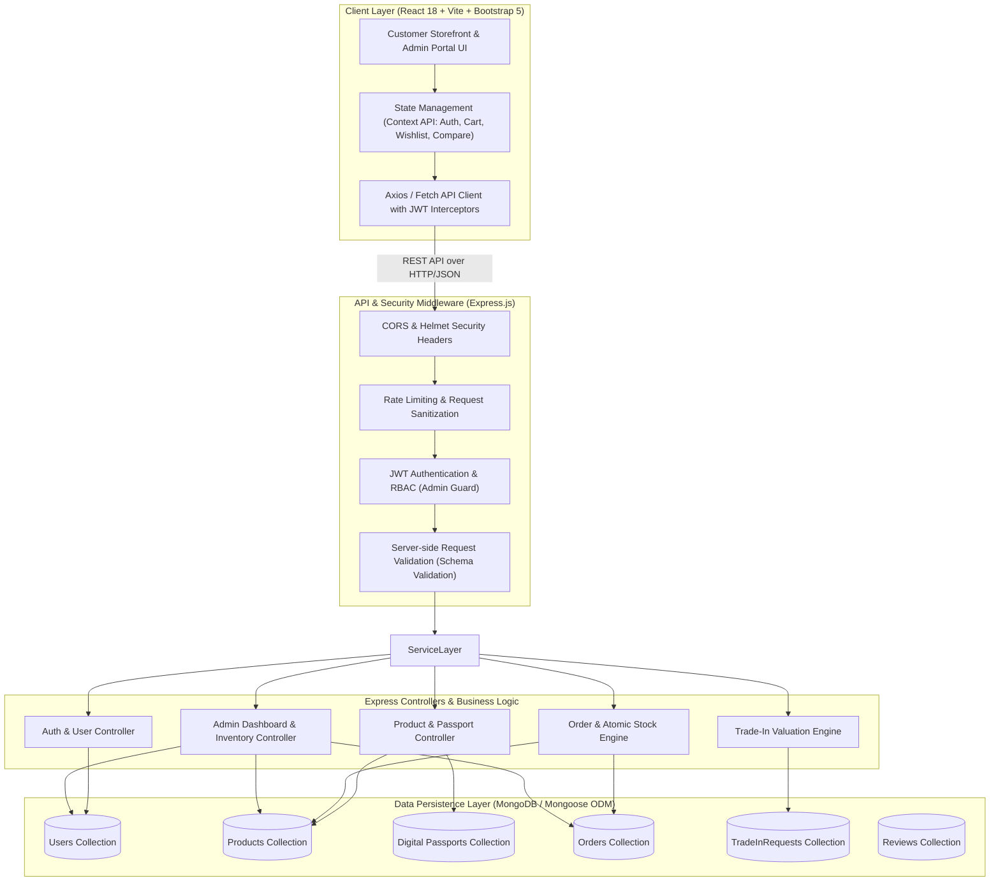

# RELOOP — System Architecture & Technical Specifications

**Refurbished Electronics E-Commerce Platform**  
*Quality renewed. Value restored.*  
**Target Milestone**: University Full Stack Development IA III Assessment  
**Document Version**: 1.0.0 (Planning Stage)

---

## 1. High-Level Architecture Overview

RELOOP is designed using a decoupled, multi-tier client-server architecture. The frontend is a single-page application (SPA) built with React and Vite, utilizing Bootstrap 5 and custom CSS tokens for responsive presentation. The backend is a Node.js Express REST API backed by MongoDB with Mongoose ODM for data modeling and persistence.



---

## 2. Directory & Workspace Structure

To ensure clean separation of concerns, the project follows a organized structure:

```
RELOOP/
├── docs/                             # Engineering and evaluation documentation
│   ├── PROJECT_PLAN.md               # Scope, pages, features, rubric mapping
│   ├── ARCHITECTURE.md               # Technical architecture & schemas (this file)
│   └── TEST_CHECKLIST.md             # Verification test suite & demo script
├── server/                           # Backend Node.js / Express application
│   ├── config/                       # Configuration & DB connection
│   │   └── db.js                     # MongoDB connection with Mongoose
│   ├── controllers/                  # Route handlers & business logic
│   │   ├── authController.js         # Register, login, profile, user management
│   │   ├── productController.js      # Public & admin catalog operations
│   │   ├── passportController.js     # Digital Product Passport operations
│   │   ├── orderController.js        # Checkout, atomic stock deduction, tracking
│   │   ├── tradeInController.js      # Trade-in estimation & submission
│   │   └── adminController.js        # Dashboard statistics & batch actions
│   ├── middleware/                   # Express middlewares
│   │   ├── authMiddleware.js         # JWT verification & customer identity
│   │   ├── roleMiddleware.js         # Role-based access control (adminOnly)
│   │   ├── errorMiddleware.js        # Centralized JSON error response handler
│   │   └── validateMiddleware.js     # Request body sanitation & validation
│   ├── models/                       # Mongoose database schemas
│   │   ├── User.js                   # Customer and admin accounts
│   │   ├── Product.js                # Refurbished catalog items & specs
│   │   ├── DigitalPassport.js        # Inspection scorecard & repair history
│   │   ├── Order.js                  # Orders, items, payment status, tracking
│   │   ├── TradeInRequest.js         # Customer device trade-in submissions
│   │   └── Review.js                 # Customer product ratings & reviews
│   ├── data/                         # Initial seeds & realistic sample data
│   │   ├── seedProducts.js           # 20+ realistic refurbished tech items
│   │   ├── seedUsers.js              # Admin & demo customer credentials
│   │   └── seeder.js                 # Automated database population script
│   ├── utils/                        # Shared backend utility functions
│   │   ├── generateToken.js          # JWT signing utility
│   │   ├── priceCalculator.js        # Server-side pricing & tax engine
│   │   └── tradeInValuator.js        # Explainable trade-in formula engine
│   ├── .env.example                  # Environment variable blueprint
│   ├── package.json                  # Server dependencies & scripts
│   └── server.js                     # Express entry point
├── client/                           # Frontend React / Vite application
│   ├── public/                       # Static public assets, favicon, logo
│   ├── src/                          # Application source code
│   │   ├── assets/                   # Images, SVG badges, brand icons
│   │   ├── components/               # Reusable UI components
│   │   │   ├── common/               # Navbar, Footer, Loader, AlertMessage, Badge
│   │   │   ├── product/              # ProductCard, ProductGrid, FilterSidebar, SortBar
│   │   │   ├── passport/             # DigitalPassportModal, DiagnosticChecklist, BatteryMeter
│   │   │   ├── compare/              # CompareTray, CompareModal, SpecMatrix
│   │   │   ├── tradein/              # TradeInWizard, ValuationSummary
│   │   │   └── admin/                # AdminSidebar, StatCard, ProductFormModal, OrderStatusBadge
│   │   ├── context/                  # React Context providers for global state
│   │   │   ├── AuthContext.jsx       # User authentication, token, role state
│   │   │   ├── CartContext.jsx       # Cart items, qty, subtotal, localStorage sync
│   │   │   ├── WishlistContext.jsx   # Wishlist items
│   │   │   └── CompareContext.jsx    # Selected devices for side-by-side comparison
│   │   ├── pages/                    # Main route views
│   │   │   ├── HomePage.jsx          # Hero, category grid, value props, featured deals
│   │   │   ├── ProductsPage.jsx      # Catalog, multi-filter, search, pagination
│   │   │   ├── ProductDetailPage.jsx # Image gallery, specs, condition breakdown, DPP drawer
│   │   │   ├── ComparePage.jsx       # Dedicated comparison view
│   │   │   ├── TradeInPage.jsx       # Step-by-step valuation calculator
│   │   │   ├── CartPage.jsx          # Shopping cart & order cost breakdown
│   │   │   ├── CheckoutPage.jsx      # Multi-step checkout with simulated payment
│   │   │   ├── OrderSuccessPage.jsx  # Order confirmation & receipt
│   │   │   ├── OrderTrackingPage.jsx # Order timeline & status stepper
│   │   │   ├── ProfilePage.jsx       # User details, past orders, trade-in history
│   │   │   ├── LoginPage.jsx         # Customer/Admin login with credentials toggle
│   │   │   ├── RegisterPage.jsx      # Customer registration
│   │   │   └── admin/                # Administrator views
│   │   │       ├── AdminDashboardPage.jsx # Live database KPIs & low-stock alerts
│   │   │       ├── AdminProductsPage.jsx  # Product catalog CRUD with search/filter
│   │   │       ├── AdminOrdersPage.jsx    # Order fulfillment & status updates
│   │   │       └── AdminTradeInsPage.jsx  # Trade-in review & voucher issuance
│   │   ├── services/                 # API client abstraction
│   │   │   ├── api.js                # Axios instance with auth interceptor
│   │   │   ├── productService.js     # Catalog and passport API calls
│   │   │   ├── orderService.js       # Order placement & history API calls
│   │   │   ├── authService.js        # Login, register, profile API calls
│   │   │   └── adminService.js       # Admin CRUD & dashboard API calls
│   │   ├── styles/                   # Custom styling & design tokens
│   │   │   └── index.css             # Theme variables, typography, light-theme utility classes
│   │   ├── App.jsx                   # React Router routing configuration
│   │   └── main.jsx                  # React DOM root entry point
│   ├── index.html                    # Root HTML document with SEO meta tags
│   ├── vite.config.js                # Vite build configuration & proxy setup
│   └── package.json                  # Frontend dependencies & scripts
└── README.md                         # Project setup, assessment summary, launch commands
```

---

## 3. Database Collections & Mongoose Schemas

### 3.1 `User` Schema
Represents customers, administrators, and inspection technicians.

```javascript
const userSchema = new mongoose.Schema({
  name: { type: String, required: true, trim: true },
  email: { type: String, required: true, unique: true, lowercase: true, trim: true },
  password: { type: String, required: true }, // Bcrypt hash with salt rounds >= 10
  role: { 
    type: String, 
    enum: ['customer', 'admin', 'inspector'], 
    default: 'customer' 
  },
  phone: { type: String, default: '' },
  shippingAddress: {
    street: { type: String, default: '' },
    city: { type: String, default: '' },
    state: { type: String, default: '' },
    postalCode: { type: String, default: '' },
    country: { type: String, default: 'India' }
  },
  wishlist: [{ type: mongoose.Schema.Types.ObjectId, ref: 'Product' }]
}, { timestamps: true });

// Indexing
userSchema.index({ email: 1 });
```

### 3.2 `Product` Schema
Represents refurbished devices and computer components with pricing, stock, condition grading, and specifications.

```javascript
const productSchema = new mongoose.Schema({
  title: { type: String, required: true, trim: true },
  slug: { type: String, required: true, unique: true, lowercase: true },
  brand: { type: String, required: true, trim: true },
  category: { 
    type: String, 
    required: true, 
    enum: ['Laptops', 'Smartphones', 'Tablets', 'PC Components'] 
  },
  subcategory: { type: String, default: '' }, // e.g. "Ultrabook", "Flagship", "GPU"
  
  // Pricing & Stock
  refurbishedPrice: { type: Number, required: true, min: 0 },
  originalRetailPrice: { type: Number, required: true, min: 0 }, // For calculated savings
  stockCount: { type: Number, required: true, min: 0, default: 0 },
  
  // Condition & Refurbishment Grading
  conditionGrade: { 
    type: String, 
    required: true, 
    enum: ['Pristine', 'Excellent', 'Good', 'Fair'] 
  },
  conditionSummary: { type: String, required: true }, // Explains cosmetic/functional tier
  
  // Media & Visuals
  images: [{ type: String, required: true }], // Validated URLs or hosted paths
  primaryImage: { type: String, required: true },
  
  // Specifications
  specifications: {
    processor: { type: String, default: 'N/A' },
    ram: { type: String, default: 'N/A' },
    storage: { type: String, default: 'N/A' },
    display: { type: String, default: 'N/A' },
    graphics: { type: String, default: 'N/A' },
    os: { type: String, default: 'N/A' },
    color: { type: String, default: 'N/A' },
    batteryHealthPercent: { type: Number, min: 0, max: 100, default: 85 }
  },
  
  warrantyMonths: { type: Number, required: true, default: 12 },
  digitalPassportId: { type: mongoose.Schema.Types.ObjectId, ref: 'DigitalPassport' },
  
  isFeatured: { type: Boolean, default: false },
  isActive: { type: Boolean, default: true },
  rating: { type: Number, default: 4.5, min: 0, max: 5 },
  reviewCount: { type: Number, default: 0 }
}, { timestamps: true });

// Search & Performance Indexes
productSchema.index({ title: 'text', brand: 'text', category: 'text' });
productSchema.index({ category: 1, refurbishedPrice: 1 });
productSchema.index({ conditionGrade: 1 });
productSchema.index({ slug: 1 }, { unique: true });
```

### 3.3 `DigitalPassport` Schema
The core innovation artifact: encapsulated inspection logs, battery metrics, parts replaced, and warranty certifications for a specific refurbished unit.

```javascript
const digitalPassportSchema = new mongoose.Schema({
  productId: { type: mongoose.Schema.Types.ObjectId, ref: 'Product', required: true, unique: true },
  deviceSerialNumber: { type: String, required: true }, // Anonymized/masked for customer view
  inspectionDate: { type: Date, default: Date.now },
  inspectorId: { type: mongoose.Schema.Types.ObjectId, ref: 'User' },
  inspectorName: { type: String, default: 'RELOOP Certified Lab' },
  
  // Diagnostic Scorecard (Pass / Minor Defect / Replaced)
  diagnosticSummaryScore: { type: Number, required: true, min: 0, max: 100, default: 95 },
  subsystemChecks: {
    screen: { status: { type: String, enum: ['Pass', 'Minor Blemish', 'Replaced OEM'], default: 'Pass' }, notes: String },
    battery: { 
      status: { type: String, enum: ['Pass', 'Replaced OEM'], default: 'Pass' }, 
      healthPercent: { type: Number, min: 0, max: 100, required: true },
      cycleCount: { type: Number, default: 120 }
    },
    chassis: { status: { type: String, enum: ['Flawless', 'Micro-scratches', 'Visible wear'], default: 'Flawless' }, notes: String },
    portsAndCharging: { status: { type: String, enum: ['Pass', 'Cleaned & Serviced'], default: 'Pass' }, notes: String },
    camerasAndSensors: { status: { type: String, enum: ['Pass', 'Serviced'], default: 'Pass' }, notes: String },
    audioAndMics: { status: { type: String, enum: ['Pass', 'Deep-cleaned'], default: 'Pass' }, notes: String },
    connectivityWifiBt: { status: { type: String, enum: ['Pass'], default: 'Pass' }, notes: String }
  },
  
  // Refurbishment Ledger
  partsReplaced: [{
    partName: { type: String, required: true },
    replacementType: { type: String, enum: ['OEM Original', 'Certified High-Grade'], default: 'OEM Original' },
    date: { type: Date, default: Date.now }
  }],
  
  // Carbon / E-waste Impact
  carbonOffsetKg: { type: Number, default: 45.2 }, // Estimated kg CO2 saved vs manufacturing new
  eWastePreventedGrams: { type: Number, default: 1850 },
  
  // Ethical Disclosure
  verificationDisclaimer: { 
    type: String, 
    default: "All diagnostics performed under RELOOP Standard Lab Protocol 4.2. Diagnostic records are verified prior to sale." 
  }
}, { timestamps: true });
```

### 3.4 `Order` Schema
Captures orders, user reference, immutable snapshot of items purchased at true unit price, shipping details, simulated payment details, and tracking timestamps.

```javascript
const orderItemSchema = new mongoose.Schema({
  product: { type: mongoose.Schema.Types.ObjectId, ref: 'Product', required: true },
  title: { type: String, required: true },
  image: { type: String, required: true },
  conditionGrade: { type: String, required: true },
  unitPrice: { type: Number, required: true, min: 0 },
  quantity: { type: Number, required: true, min: 1 },
  subtotal: { type: Number, required: true, min: 0 }
});

const orderSchema = new mongoose.Schema({
  orderNumber: { type: String, required: true, unique: true }, // e.g., "RLP-2026-94821"
  user: { type: mongoose.Schema.Types.ObjectId, ref: 'User', required: true },
  orderItems: [orderItemSchema],
  
  shippingAddress: {
    fullName: { type: String, required: true },
    phone: { type: String, required: true },
    street: { type: String, required: true },
    city: { type: String, required: true },
    state: { type: String, required: true },
    postalCode: { type: String, required: true },
    country: { type: String, default: 'India' }
  },
  
  // Strict Server-Side Financials
  pricing: {
    itemsSubtotal: { type: Number, required: true, min: 0 },
    shippingFee: { type: Number, required: true, default: 0 },
    estimatedTax: { type: Number, required: true, min: 0 },
    discountAmount: { type: Number, default: 0 },
    totalPrice: { type: Number, required: true, min: 0 }
  },
  
  // Safe Simulated Payment Information (Zero Raw Card Data)
  paymentDetails: {
    paymentMethod: { type: String, required: true, enum: ['Simulated Card', 'UPI Simulator', 'Cash on Delivery'] },
    status: { type: String, required: true, enum: ['Paid', 'Pending', 'Failed'], default: 'Paid' },
    transactionId: { type: String, required: true },
    cardBrand: { type: String, default: 'Visa' },
    cardLast4: { type: String, default: '4242' },
    paidAt: { type: Date, default: Date.now }
  },
  
  orderStatus: {
    type: String,
    enum: ['Order Placed', 'Inspected & Packed', 'Dispatched', 'Out for Delivery', 'Delivered', 'Cancelled'],
    default: 'Order Placed'
  },
  
  statusTimeline: [{
    status: { type: String, required: true },
    timestamp: { type: Date, default: Date.now },
    note: { type: String, default: '' }
  }]
}, { timestamps: true });

orderSchema.index({ user: 1, createdAt: -1 });
orderSchema.index({ orderNumber: 1 }, { unique: true });
orderSchema.index({ orderStatus: 1 });
```

### 3.5 `TradeInRequest` Schema
Manages customer device trade-in valuations, diagnostic submissions, and administrative voucher approvals.

```javascript
const tradeInRequestSchema = new mongoose.Schema({
  user: { type: mongoose.Schema.Types.ObjectId, ref: 'User', required: true },
  deviceCategory: { type: String, required: true, enum: ['Laptops', 'Smartphones', 'Tablets'] },
  brand: { type: String, required: true },
  modelName: { type: String, required: true },
  specifications: { type: String, default: '' },
  
  // Customer Self-Reported Diagnostics
  functionalState: {
    powersOn: { type: Boolean, required: true },
    screenIntact: { type: Boolean, required: true },
    touchResponsive: { type: Boolean, required: true },
    camerasWork: { type: Boolean, required: true },
    batteryWorking: { type: Boolean, required: true }
  },
  cosmeticGrade: { 
    type: String, 
    enum: ['Flawless', 'Good (Minor Scratches)', 'Fair (Heavy Wear)', 'Damaged'], 
    required: true 
  },
  
  // Explainable Valuation
  estimatedValue: { type: Number, required: true, min: 0 },
  valuationBreakdown: {
    baseModelValue: Number,
    cosmeticMultiplier: Number,
    functionalDeductions: Number
  },
  
  status: { 
    type: String, 
    enum: ['Submitted', 'Under Lab Inspection', 'Approved', 'Rejected', 'Voucher Issued'], 
    default: 'Submitted' 
  },
  approvedValue: { type: Number },
  voucherCode: { type: String, default: '' },
  inspectorNotes: { type: String, default: '' },
  
  // Regulatory Disclaimer
  verificationDisclosure: {
    type: String,
    default: "Submitted diagnostics are provisional estimates. Final voucher requires physical verification at RELOOP testing center."
  }
}, { timestamps: true });

tradeInRequestSchema.index({ user: 1, createdAt: -1 });
tradeInRequestSchema.index({ status: 1 });
```

---

## 4. REST API Specification

### 4.1 Authentication & User Endpoints (`/api/auth`)

| Method | Endpoint | Access | Request Body | Description | Success Response |
|---|---|---|---|---|---|
| `POST` | `/api/auth/register` | Public | `{ name, email, password, phone }` | Register new customer account | `201 Created` + `{ token, user }` |
| `POST` | `/api/auth/login` | Public | `{ email, password }` | Authenticate user & issue JWT | `200 OK` + `{ token, user }` |
| `GET` | `/api/auth/me` | Authenticated | *None* (Bearer Token) | Retrieve authenticated profile | `200 OK` + `{ user }` |
| `PUT` | `/api/auth/profile` | Authenticated | `{ name, phone, shippingAddress }` | Update account profile | `200 OK` + `{ user }` |

### 4.2 Product & Catalog Endpoints (`/api/products`)

| Method | Endpoint | Access | Query Parameters / Body | Description | Success Response |
|---|---|---|---|---|---|
| `GET` | `/api/products` | Public | `?search=&category=&grade=&minPrice=&maxPrice=&sort=&page=&limit=` | Filtered & paginated product catalog | `200 OK` + `{ products, total, page, pages }` |
| `GET` | `/api/products/featured` | Public | *None* | Top deals and highlighted refurbs | `200 OK` + `{ products: [...] }` |
| `GET` | `/api/products/:slug` | Public | *None* (URL param) | Full product details + specs | `200 OK` + `{ product }` |
| `GET` | `/api/products/:id/passport` | Public | *None* (Product ID) | Retrieve Digital Product Passport | `200 OK` + `{ passport }` |
| `POST` | `/api/products/compare` | Public | `{ productIds: [id1, id2, ...] }` | Side-by-side comparison payload | `200 OK` + `{ comparisonMatrix: [...] }` |

### 4.3 Order & Checkout Endpoints (`/api/orders`)

| Method | Endpoint | Access | Request Body | Description | Success Response |
|---|---|---|---|---|---|
| `POST` | `/api/orders` | Authenticated | `{ items: [{ productId, quantity }], shippingAddress, paymentDetails }` | Server-validated checkout with atomic stock update | `201 Created` + `{ order }` |
| `GET` | `/api/orders/my-orders` | Authenticated | *None* | Authenticated customer's order history | `200 OK` + `{ orders: [...] }` |
| `GET` | `/api/orders/:orderId` | Authenticated | *None* | Full order receipt and status timeline | `200 OK` + `{ order }` |

### 4.4 Trade-In Valuation Endpoints (`/api/trade-in`)

| Method | Endpoint | Access | Request Body | Description | Success Response |
|---|---|---|---|---|---|
| `POST` | `/api/trade-in/calculate` | Public | `{ category, brand, modelName, functionalState, cosmeticGrade }` | Real-time explainable estimate calculation | `200 OK` + `{ estimatedValue, breakdown }` |
| `POST` | `/api/trade-in/submit` | Authenticated | Complete trade-in payload | Submit device for official inspection | `201 Created` + `{ tradeInRequest }` |
| `GET` | `/api/trade-in/my-requests` | Authenticated | *None* | Customer's submitted trade-in history | `200 OK` + `{ requests: [...] }` |

### 4.5 Administrator Management Endpoints (`/api/admin`)

| Method | Endpoint | Access | Request Body / Query | Description | Success Response |
|---|---|---|---|---|---|
| `GET` | `/api/admin/dashboard` | Admin Only | *None* | Database-derived KPIs, low-stock, revenue | `200 OK` + `{ metrics, recentOrders, alerts }` |
| `POST` | `/api/admin/products` | Admin Only | Complete product + passport JSON payload | Create new refurbished product | `201 Created` + `{ product }` |
| `PUT` | `/api/admin/products/:id` | Admin Only | Partial/Full product update payload | Update pricing, stock, specs, or images | `200 OK` + `{ product }` |
| `DELETE` | `/api/admin/products/:id` | Admin Only | *None* | Remove or archive product | `200 OK` + `{ message: "Deleted" }` |
| `GET` | `/api/admin/orders` | Admin Only | `?status=&page=&limit=` | Master list of all orders across customers | `200 OK` + `{ orders, total }` |
| `PATCH` | `/api/admin/orders/:id/status`| Admin Only | `{ status: "Dispatched", note: "Shipped" }` | Step order along fulfillment lifecycle | `200 OK` + `{ order }` |
| `GET` | `/api/admin/trade-ins` | Admin Only | `?status=` | List all customer trade-in submissions | `200 OK` + `{ tradeIns }` |
| `PATCH` | `/api/admin/trade-ins/:id` | Admin Only | `{ status: "Approved", approvedValue: 8500, voucherCode: "RLP-TRADE85" }` | Approve trade-in & issue voucher | `200 OK` + `{ tradeIn }` |

---

## 5. Security & Business Logic Integrity

### 5.1 Server-Side Price & Stock Validation (Anti-Tampering)
Client-submitted prices are **never trusted**. When `/api/orders` receives an order:
1. The server extracts the `productId` and `quantity` from each item.
2. The server queries MongoDB to fetch the authoritative `refurbishedPrice` and `stockCount` directly from the database.
3. If any item has `stockCount < quantity`, the entire transaction is rejected with `400 Bad Request` ("Item [Title] is out of stock").
4. The server recalculates `itemsSubtotal`, calculates shipping (free if subtotal > ₹999, else ₹99), and computes standard tax (18% GST).
5. The final total is computed on the server and matched against the order.

### 5.2 Atomic Inventory Decrement (Preventing Negative Stock)
To prevent race conditions where two simultaneous buyers purchase the last remaining refurbished unit:
```javascript
// Atomic update using MongoDB condition guard
const updatedProduct = await Product.findOneAndUpdate(
  { _id: item.productId, stockCount: { $gte: item.quantity } },
  { $inc: { stockCount: -item.quantity } },
  { new: true }
);

if (!updatedProduct) {
  throw new Error(`Insufficient stock for ${item.title}. Order cannot be processed.`);
}
```

### 5.3 Authentication & Role-Based Access Control (RBAC)
- Passwords hashed using `bcryptjs` with salt round factor of 10 before saving.
- Authentication tokens generated via JSON Web Token (`jsonwebtoken`) signed with a server secret `JWT_SECRET` and set to expire in 7 days.
- Express middleware pipeline:
  - `protect`: Verifies `Bearer <token>` header, decodes user ID, attaches `req.user` from database.
  - `adminOnly`: Inspects `req.user.role === 'admin'`. Returns `403 Forbidden` if unauthorized.

### 5.4 Safe Payment Simulation (Zero Card Data Storage)
- RELOOP does not store or process raw credit card numbers, CVVs, or bank credentials.
- The checkout interface includes a clearly labelled **"Simulated Payment Gateway (Assessment Sandbox)"**.
- Front-end validation verifies standard Luhn 16-digit card formatting, valid expiry dates, and 3-digit CVV.
- The backend records a simulated transaction ID (e.g., `TXN-SIM-7821948`) and stores only the last 4 digits (`4242`) and card brand for receipt printing.

### 5.5 Regulatory Diagnostic Disclaimers
In accordance with fair trade principles for refurbished goods:
- All customer-facing Digital Product Passports display a prominent verification badge stating whether testing was performed by RELOOP technicians.
- The Trade-In Valuation Calculator includes a mandatory disclosure note:  
  *“Estimated trade-in amounts are subject to physical hardware verification at our refurbishment facility before store credit is released.”*

---

## 6. Frontend Architecture & Design System

### 6.1 Theme Tokens & Visual Variables
Standardized in `client/src/styles/index.css`:
```css
:root {
  /* Brand Palette */
  --reloop-navy: #102A43;
  --reloop-navy-dark: #0A1B2A;
  --reloop-navy-light: #243B53;
  --reloop-green: #16804A;
  --reloop-green-hover: #12663A;
  --reloop-green-light: #E8F5E9;
  
  /* Neutral Canvas */
  --reloop-bg: #F8FAFC;
  --reloop-card-bg: #FFFFFF;
  --reloop-border: #E2E8F0;
  --reloop-text-primary: #0F172A;
  --reloop-text-muted: #64748B;
  
  /* Condition Grade Accents */
  --grade-pristine: #16804A;
  --grade-excellent: #0284C7;
  --grade-good: #D97706;
  --grade-fair: #E11D48;
  
  /* Shadows & Elevation */
  --shadow-sm: 0 1px 3px rgba(16, 42, 69, 0.08);
  --shadow-md: 0 4px 6px -1px rgba(16, 42, 69, 0.1), 0 2px 4px -1px rgba(16, 42, 69, 0.06);
  --shadow-lg: 0 10px 15px -3px rgba(16, 42, 69, 0.1), 0 4px 6px -2px rgba(16, 42, 69, 0.05);
  
  /* Border Radii */
  --radius-card: 10px;
  --radius-btn: 6px;
  --radius-pill: 9999px;
}
```

### 6.2 Responsive Breakpoint Strategy
- **Mobile (< 768px)**: Collapsible hamburger menu, off-canvas filter drawer, single-column product grid, sticky mobile checkout button.
- **Tablet (768px - 1024px)**: 2-column product grid, top filter chips, modal-driven comparison.
- **Desktop (> 1024px)**: Persistent 4-column product grid, sticky sidebar filters, sticky order summary card, full side-by-side comparison table.
